# SREDA AI — Multimodal Workstation

<p align="center">
  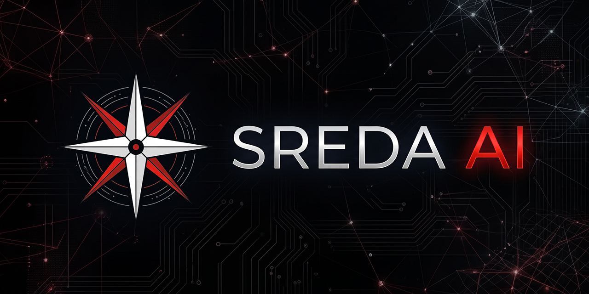
</p>

<p align="center">
  <a href="README.md"><b>🇬🇧 English Version (Current)</b></a> •
  <a href="README_RU.md"><b>🇷🇺 Читать на русском (Russian)</b></a>
</p>

<p align="center">
  <strong>Modern Local Multimodal Artificial Intelligence Workstation for Windows</strong><br>
  Text • Vision • Speech • Image Generation • Music • RAG • Cloud APIs • SREDA Boost
</p>

<p align="center">
  
  
  
  
  
  
  
</p>

---

## 📸 Visual Showcase & User Interface

### 1. Main Dashboard & Chat Workspace
Sleek cyberpunk dark theme, real-time inference radar indicator, instant engine lifecycle controls, multimedia file attachments, image generation prompt bar, and voice mode.
<p align="center">
  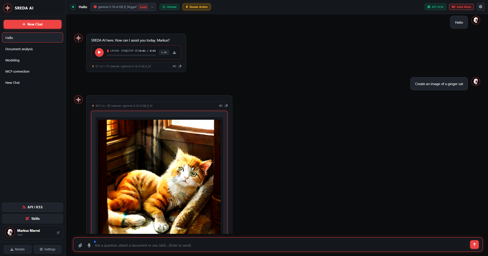
</p>

### 2. Local Model Catalog & Hugging Face GGUF Hub
Automatic scanning of local `.gguf` weights, one-click load/unload, file deletion, and direct search across Hugging Face with real-time RAM compatibility analysis.
<p align="center">
  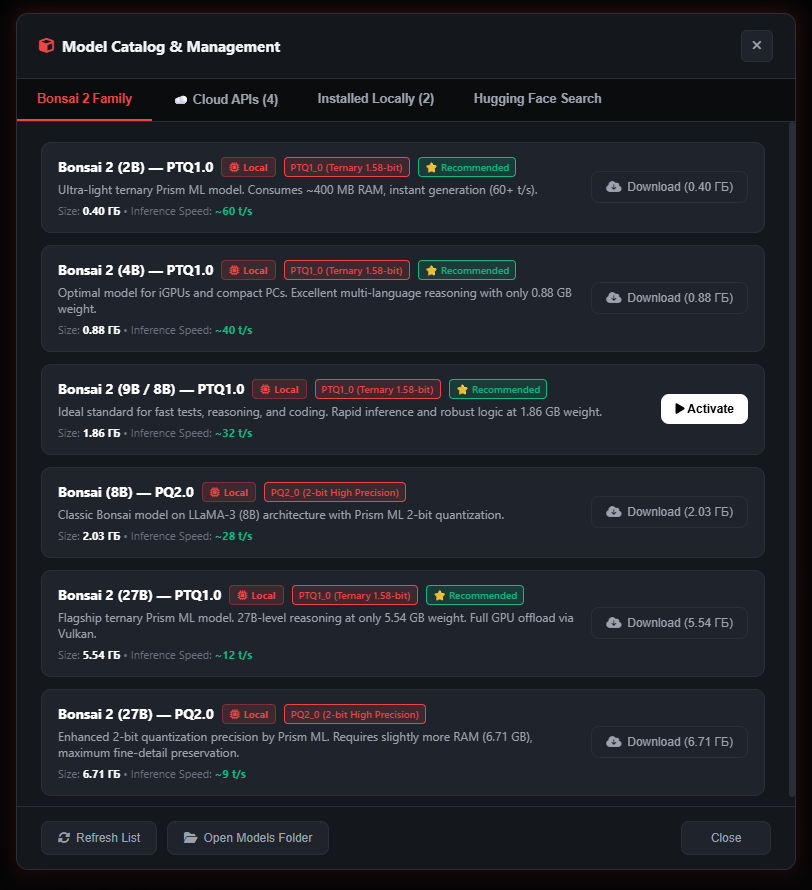
  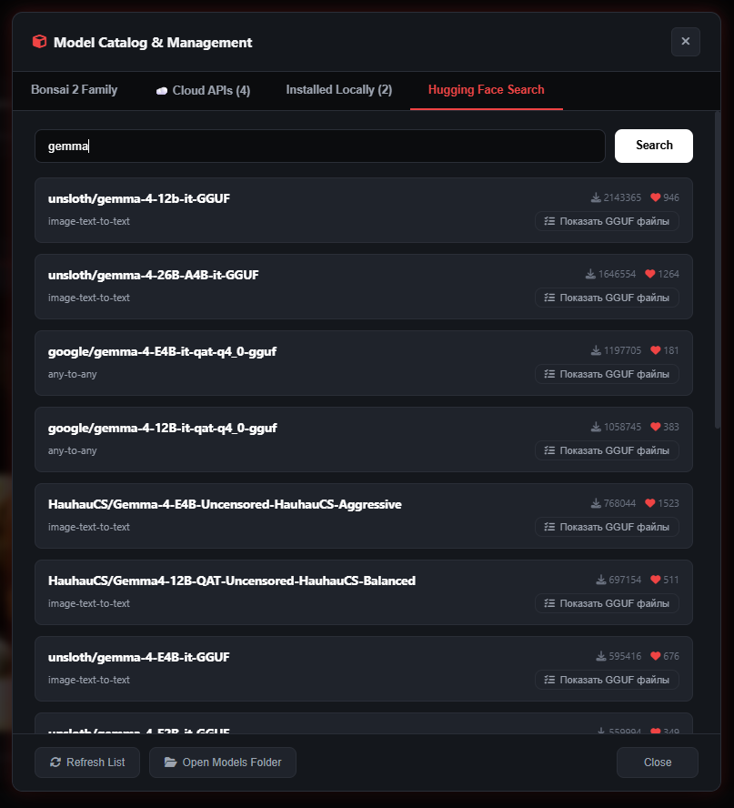
</p>

### 3. Vulkan Hardware Acceleration, SREDA Boost & Cloud AI
Granular control over GPU offloading layers, CPU threads, 8192+ context with Flash Attention, SREDA Boost RAM trim mode, plus zero-VRAM cloud integrations with Sber GigaChat and OpenRouter.
<p align="center">
  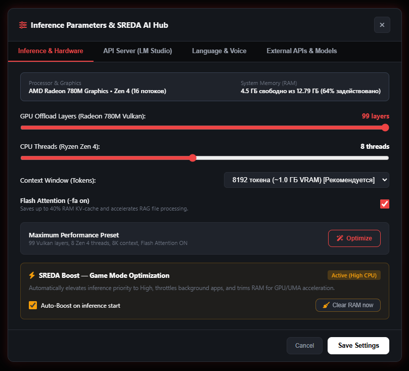
  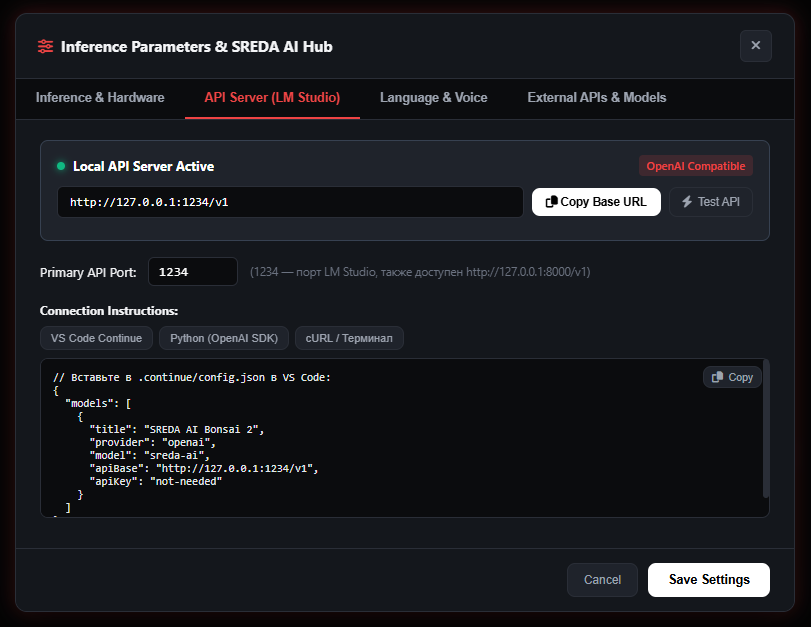
</p>

### 4. 9-Language Localization, Piper Neural Voice & Local API Server
Dynamic switching across 9 languages without page reload, offline neural voice synthesis with Piper (Russian & English), and built-in OpenAI-compatible server (`localhost:1234`).
<p align="center">
  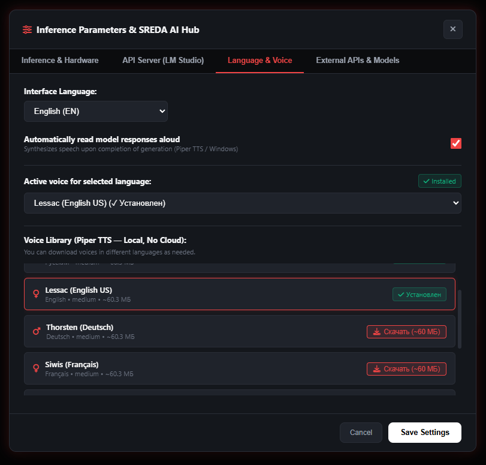
  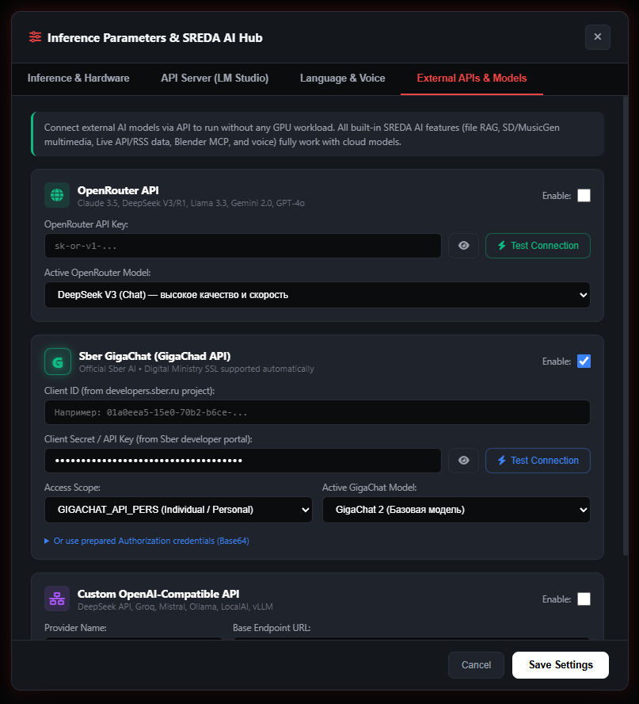
</p>

### 5. Automation Skills, Real-Time Data Hub & Diagnostics
Integrated skills automation library, Blender 3D MCP tools, live Central Bank currency rates, RSS news feeds, and live CPU/GPU/RAM hardware telemetry.
<p align="center">
  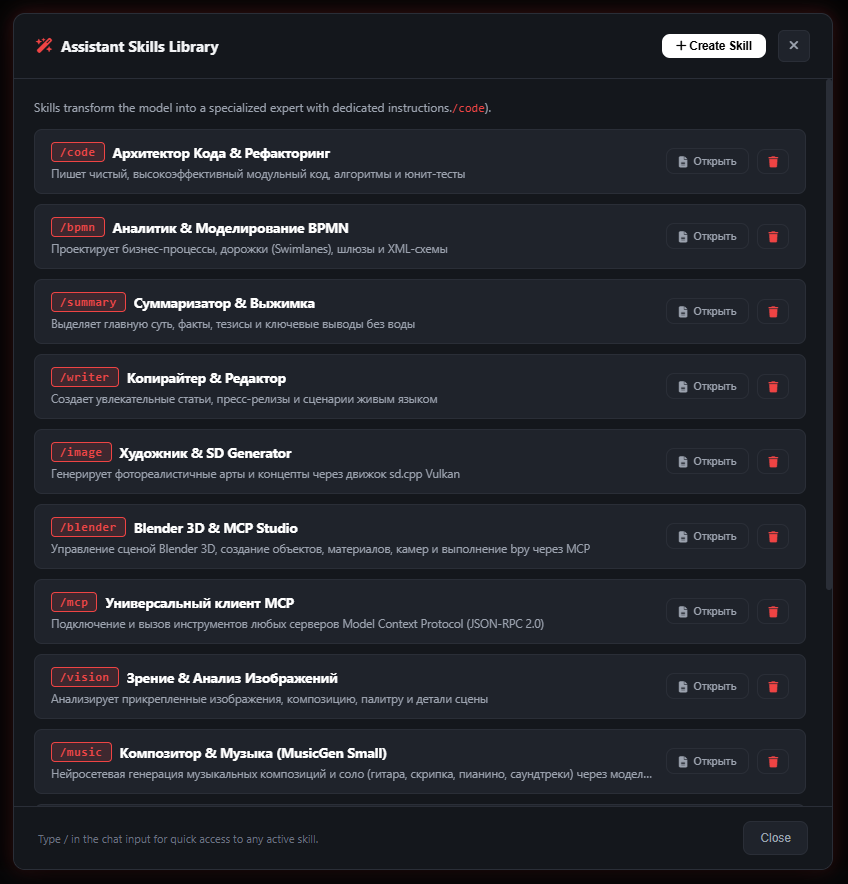
  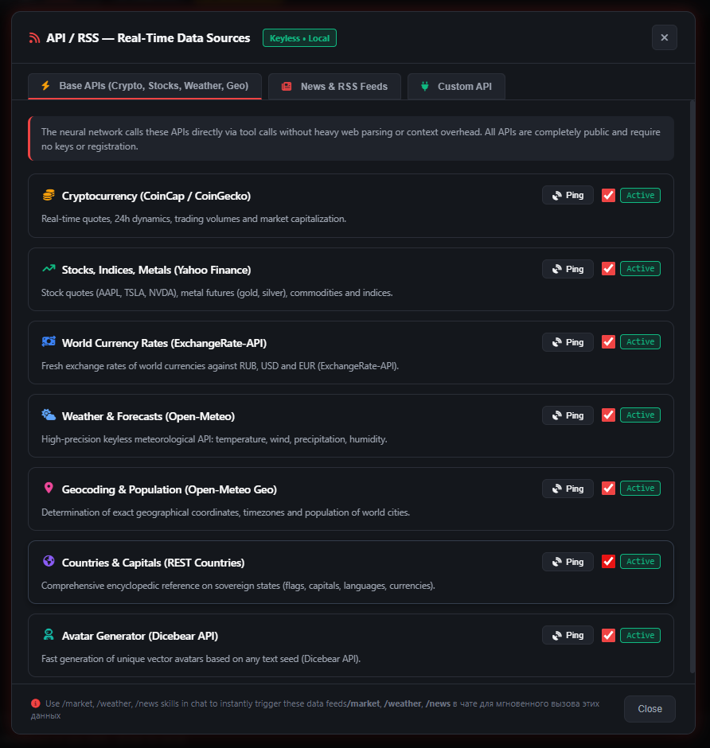
  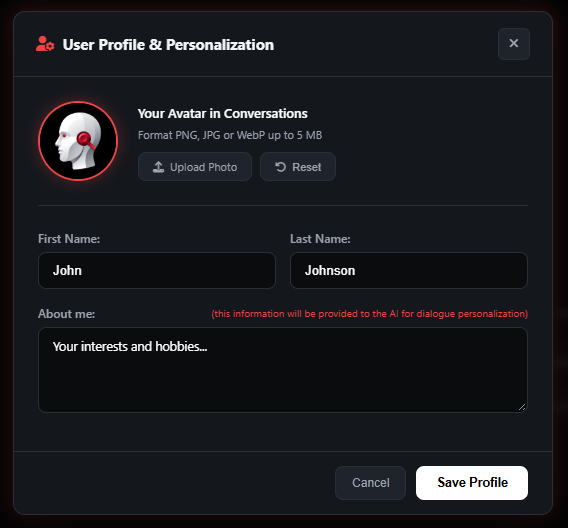
</p>

---

## ⚠️ Important Beta Notice

> **Release Status:** **v9.0-beta**  
> This multimodal workstation is an active **Beta release**.  
> The system has been comprehensively developed, benchmarked, and optimized on:  
> **AMD Ryzen (Zen 4, 16 threads) + AMD Radeon 780M (Vulkan GPU Acceleration) on Windows 11** with quantized **Bonsai (Ternary-Bonsai-2-9B / Bonsai-8B)** and **Gemma** model families.
> 
> *The workstation architecture is universally designed to run smoothly on AMD Radeon, NVIDIA GeForce/RTX, and Intel Arc / Iris Xe graphics on Windows 10 & 11 without driver conflicts.*

---

## 🌟 Key Features

### 1. ⚡ SREDA Boost — High-Performance Game Mode
- **Compute Prioritization:** Automatically elevates inference process (`llama-server.exe`) to `High` priority, guaranteeing smooth token streaming without stutter.
- **Smart RAM Compaction (Working Set Trim):** Invokes the Windows Working Set Trim API (`SetProcessWorkingSetSize`) on demand and prior to model initialization, reclaiming hundreds of megabytes of RAM for the graphics core (UMA / VRAM).
- **Hardware-Friendly Throttling:** Built-in Whitelist protects critical GPU driver processes from **AMD** (`amdfendrs`, `radeonsoftware`), **NVIDIA** (`nvcontainer`, `nvdisplay`), **Intel** (`igfx`, `arccontrol`), and core Windows services.

### 2. 🧠 Local LLM Inference Engine
- Full-featured local backend powered by high-performance `llama-server` with native **Vulkan** hardware acceleration.
- **Flash Attention (`-fa on`)** support, slashing VRAM consumption by up to 40% on long contexts and accelerating RAG query processing.
- Flexible context lengths up to 8192+ tokens and adjustable GPU offloading (0–99 layers).
- Integrated Hugging Face Hub search to discover and download **GGUF** quantized models directly from the UI.

### 3. 🌐 Cloud Model APIs (0 MB Local VRAM Footprint)
Need maximum intelligence without an expensive discrete graphics card? Connect premier cloud models seamlessly:
- **Sber GigaChat:** Official support for `GigaChat 2 Max`, `GigaChat 2 Pro`, `GigaChat 2`, and `GigaChat 1.x`. Supports Client ID / Secret, Base64 auth keys, and automatic TLS validation with Russian digital certificates.
- **OpenRouter:** Instant access to `DeepSeek V3`, `DeepSeek R1` (deep reasoning), `Claude 3.5 Sonnet`, `Llama 3.3 70B`, `GPT-4o`, and free tiers.
- **Custom OpenAI-Compatible APIs:** Connect local hosts (vLLM, Ollama, LM Studio) or third-party inference providers.

### 4. 🎙️ Full Offline Voice Pipeline
- **Offline Speech-to-Text (Whisper):** Fast, accurate speech recognition from microphone without sending voice data to external servers.
- **Offline Text-to-Speech (Piper Neural Voices):** Studio-grade neural voice synthesis in Russian (*Dmitri*, *Irina*) and English (*Lessac*).
- **Auto-Readout (Hands-Free Mode):** Natural real-time voice conversation where the assistant automatically speaks responses.
- **On-Demand Downloads:** Download neural voice packs directly from Settings (~60 MB each).

### 5. 🎨 Generative Graphics, Music & Computer Vision
- **Stable Diffusion (SDXS-512):** Ultra-fast distilled image synthesis in 1–2 steps via Vulkan.
- **Procedural & Neural Music:** Synthesize melody tracks and acoustic guitar simulations (Karplus-Strong / MusicGen ONNX).
- **Computer Vision:** Image understanding and automatic scene captioning for uploaded images and screenshots (ViT-GPT2).

### 6. 📚 RAG & Real-Time Data Hub
- Document parsing and vector indexing for **PDF, DOCX, TXT, and Markdown**.
- Live Data Feeds: Central Bank currency rates, live RSS news feeds, weather forecasts, and web summaries.
- 3D Modeling Automation: Connect with **Blender MCP** to control 3D viewport scenes and generative assets.

---

## 🖥️ System Requirements & Hardware Compatibility

| Component | Minimum Requirements | Recommended Requirements |
| :--- | :--- | :--- |
| **Operating System** | Windows 10 (64-bit, 20H2+) | Windows 11 (64-bit, 22H2 / 23H2 / 24H2) |
| **Processor (CPU)** | 4 Cores / 8 Threads (Intel Core i5 / AMD Ryzen 5) | 8 Cores / 16 Threads (AMD Ryzen Zen 4 / Intel 13th+ Gen) |
| **Memory (RAM)** | 8 GB (for Cloud API or 3B models) | 16–32 GB (for 7B–9B models & multimodality) |
| **Graphics (GPU)** | Any Vulkan 1.2+ capable GPU or CPU | AMD Radeon 780M / RX 6000+, NVIDIA RTX 3060+, Intel Arc A770 |
| **Python** | Python 3.10 – 3.14 | Python 3.11 or 3.12 |

---

## 🚀 Installation & Quickstart

### Step 1. Clone the Repository
```bash
git clone https://github.com/MarkusMarrei/sreda-ai.git
cd sreda-ai
```

### Step 2. Install Python Dependencies
Using standard Python 3.10+ virtual environment is recommended:
```bash
pip install -r requirements.txt
```

### Step 3. Set Up Neural Models (One-Click Setup)
Heavy model weights (>100 MB) are kept outside the Git repository. Download the components you need with the helper script:
```bash
setup_models.bat
# or via Python:
python download_models.py
```
*You can choose to install only voice models (~260 MB), image generation (~650 MB), text model Bonsai 2 (~1.9 GB), or use Cloud APIs exclusively with 0 MB disk footprint.*

### Step 4. Launch the Workstation
Double-click:
```bash
run.bat
# or execute in terminal:
python run.py
```
The launcher will automatically:
1. Validate and clear ports `8000`, `8080`, and `1234`.
2. Generate a custom **SREDA AI** shortcut on your Windows Desktop.
3. Start the FastAPI backend and open the workstation in a dedicated application window.

---

## 📁 Project Architecture

```
SREDA-AI/
├── backend/                  # Server Core (FastAPI, Python)
│   ├── main.py               # Main API router and WebSocket streaming
│   ├── llama_engine.py       # llama-server process lifecycle management
│   ├── boost_service.py      # SREDA Boost process & RAM trim service
│   ├── provider_service.py   # Cloud API provider integration (GigaChat, OpenRouter)
│   ├── audio_service.py      # Piper TTS synthesis & Whisper STT recognition
│   ├── multimedia_orchestrator.py # Image and music generation dispatcher
│   ├── system_info.py        # CPU, GPU (AMD/NVIDIA/Intel) and RAM diagnostics
│   ├── hf_hub.py             # Hugging Face Hub GGUF search & download manager
│   ├── rag_service.py        # Vector document indexing and retrieval
│   ├── data_hub_service.py   # Live RSS feeds, Central Bank currency rates
│   └── config/               # Configuration templates (boost, providers)
├── docs/                     # Documentation & visual assets
│   └── screenshots/          # Workstation UI screenshots & showcase
├── engine/                   # Pre-compiled native inference binaries
│   ├── llama-server.exe      # High-performance Vulkan inference engine
│   ├── ffmpeg.exe            # Media stream converter
│   ├── sd/                   # Stable Diffusion engine (sd-cli.exe)
│   └── audio/                # Piper.exe and whisper-cli.exe binaries
├── frontend/                 # Workstation User Interface
│   ├── index.html            # SPA interface, responsive modal dialogs
│   ├── css/theme.css         # Neon cyberpunk dark theme & CSS animations
│   ├── js/app.js             # Client SPA logic & I18N localization
│   └── assets/               # Logos, icons, default user avatars
├── models/                   # Local weights directory (.gitkeep)
│   ├── audio/                # Piper TTS voices & Whisper models
│   ├── sd/                   # Stable Diffusion GGUF models
│   └── vision/               # Computer vision models
├── download_models.py        # Automated model asset downloader
├── setup_models.bat          # One-click downloader batch script
├── run.py                    # Main workstation launcher with health monitoring
├── run.bat                   # 1-Click Windows execution script
├── requirements.txt          # Python package requirements
├── LICENSE                   # Apache License 2.0
├── README.md                 # English documentation (Primary)
└── README_RU.md              # Russian documentation
```

---

## 🌍 Multilingual Localization (9 Languages)

SREDA AI features instant runtime language switching without restarting or page reloads:
- **English (EN)**
- **Russian (RU)**
- **German (DE)**, **French (FR)**, **Spanish (ES)**, **Portuguese (PT)**, **Italian (IT)**, **Japanese (JA)**, **Korean (KO)**

System metadata and author attribution dynamically adjust:
- EN: **Author: Markus Marrei** | **Version: v9.0-beta**
- RU: **Автор: Маркус Маррей** | **Версия: v9.0-beta**

---

## 🔒 Privacy & Clean Repository Policy

- All personal directories, local cache logs, and personal credentials have been completely scrubbed.
- `backend/config/providers.json` provides clean template structures and is excluded via `.gitignore`.
- Your local chat logs, RAG documents, and generated media remain 100% private on your machine.

---

## 📜 License

Distributed under the **Apache License 2.0**.  
See [LICENSE](LICENSE) for full details.

```text
Copyright 2026 Markus Marrei (Маркус Маррей)

Licensed under the Apache License, Version 2.0 (the "License");
you may not use this file except in compliance with the License.
You may obtain a copy of the License at

    http://www.apache.org/licenses/LICENSE-2.0
```

---

<p align="center">
  Engineered for ultimate local AI privacy and hardware efficiency.<br>
  <strong>Markus Marrei (Маркус Маррей) • SREDA AI</strong>
</p>
