# SREDA AI — Мультимодальная рабочая станция

<p align="center">
  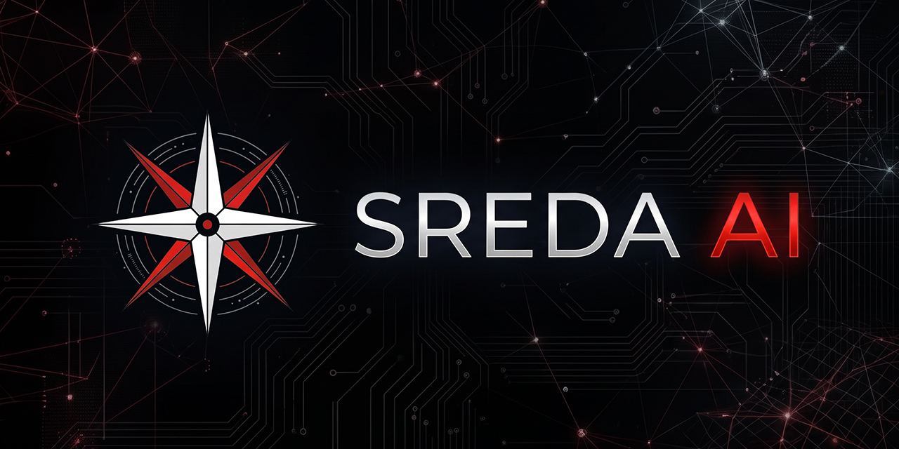
</p>

<p align="center">
  <a href="README.md"><b>🇬🇧 English Version</b></a> •
  <a href="README_RU.md"><b>🇷🇺 Русская версия (Текущая)</b></a>
</p>

<p align="center">
  <strong>Современная локальная мультимодальная рабочая станция искусственного интеллекта для Windows</strong><br>
  Текст • Зрение • Речь • Генерация изображений • Музыка • RAG • Внешние API • SREDA Boost
</p>

<p align="center">
  
  
  
  
  
  
  
</p>

---

## 📸 Галерея интерфейса (Visual Showcase)

### 1. Главный экран и интерактивный диалог
Интуитивная темная тема, радар состояния инференса, быстрое управление движком, прикрепление файлов, генерация картинок и аудиорежим.
<p align="center">
  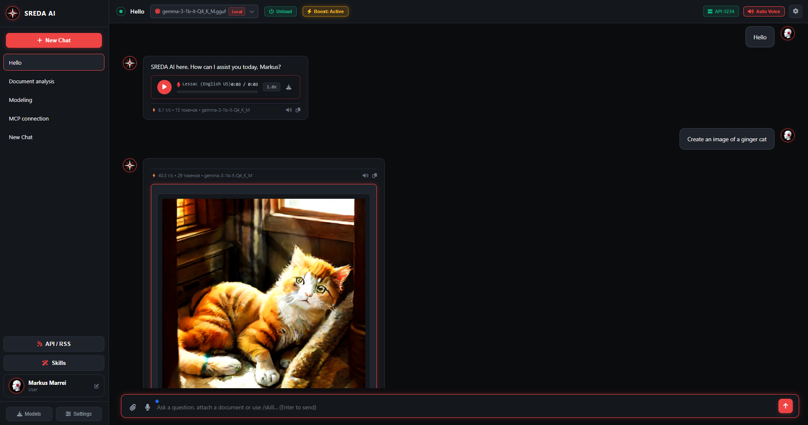
</p>

### 2. Каталог локальных моделей и поиск на Hugging Face
Автоматическое обнаружение установленных `.gguf` моделей, однократная активация, удаление и поиск квантованных моделей прямо из Hugging Face с живым расчетом совместимости по RAM.
<p align="center">
  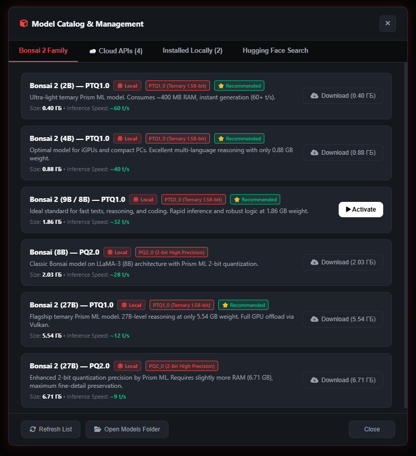
  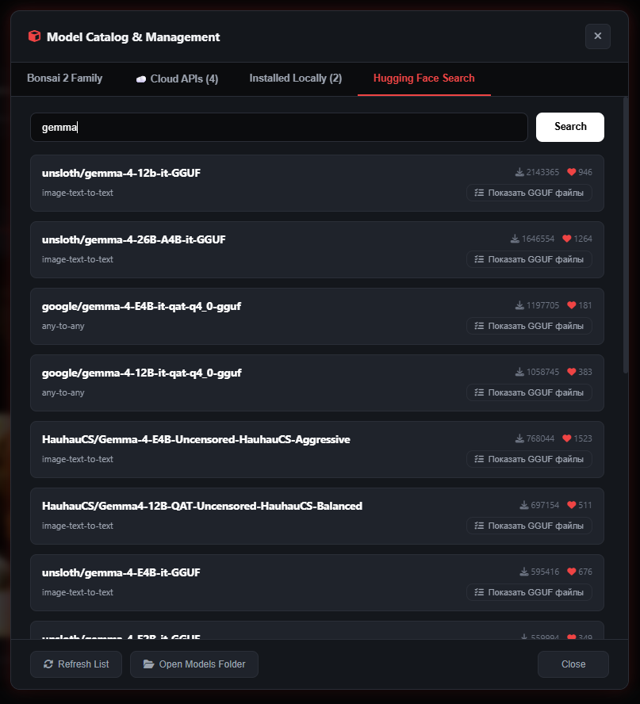
</p>

### 3. Настройки инференса Vulkan, SREDA Boost и облачные нейросети
Тонкая настройка GPU-слоев, потоков CPU, контекста до 8192+ с Flash Attention, игровой режим ресурсов SREDA Boost, а также подключение Сбер GigaChat и OpenRouter (0 МБ VRAM).
<p align="center">
  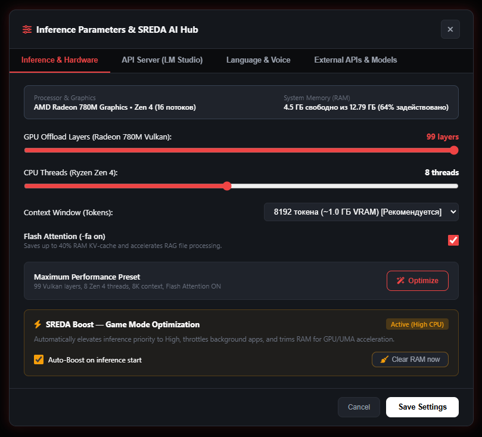
  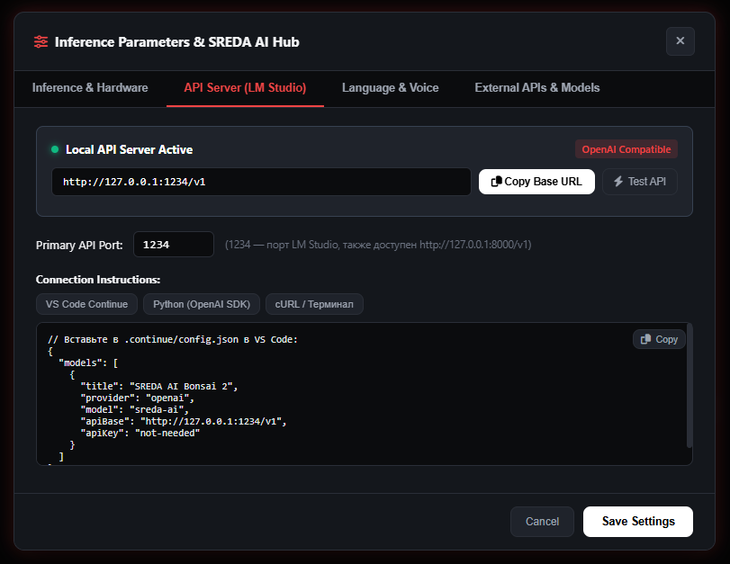
</p>

### 4. Мультиязычность, нейроозвучка Piper и локальный API-сервер
Мгновенное переключение между 9 языками интерфейса, офлайн озвучка русскими и английскими голосами нейросети Piper, а также встроенный OpenAI-совместимый сервер (`localhost:1234`).
<p align="center">
  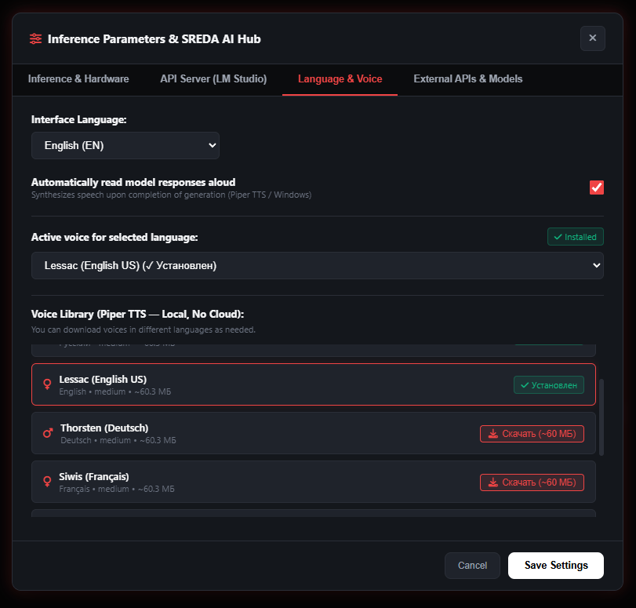
  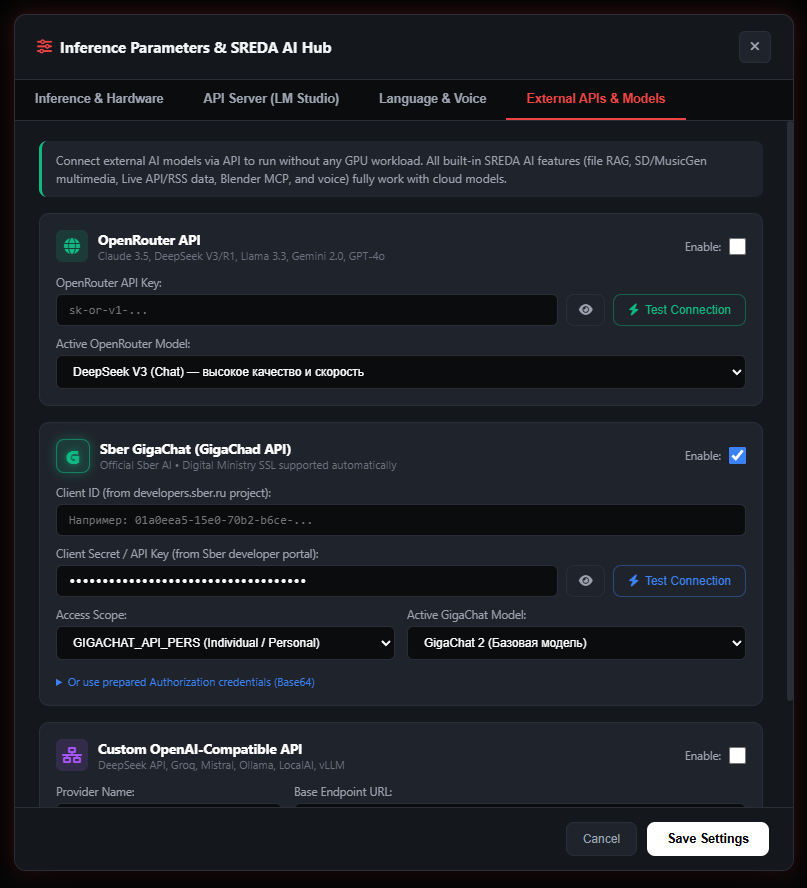
</p>

### 5. Центр навыков, хаб живых данных и диагностика системы
Встроенная библиотека навыков автоматизации, интеграция с Blender MCP, курсы валют ЦБ РФ, новости по RSS, мониторинг доступной оперативной памяти и видеоядра.
<p align="center">
  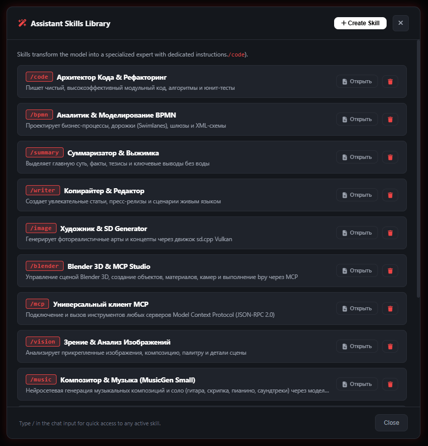
  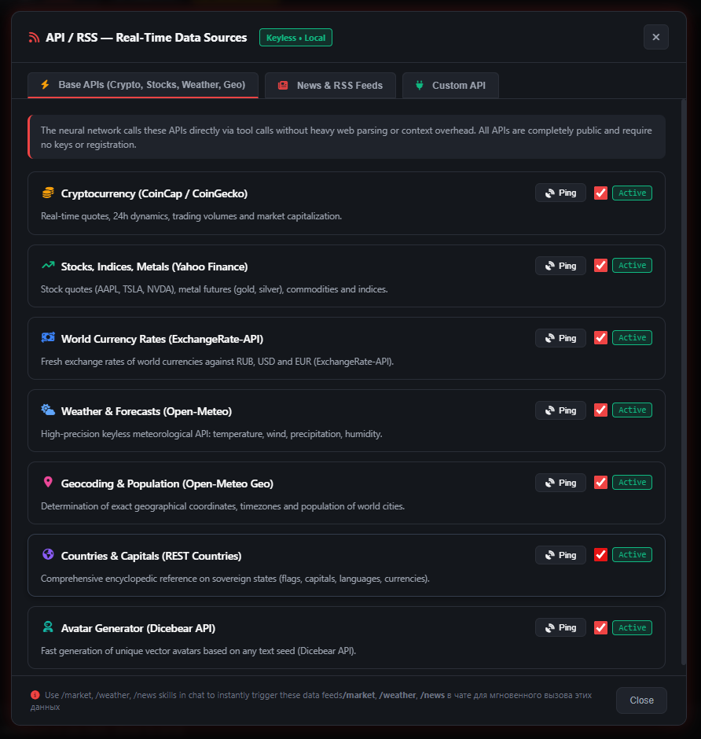
  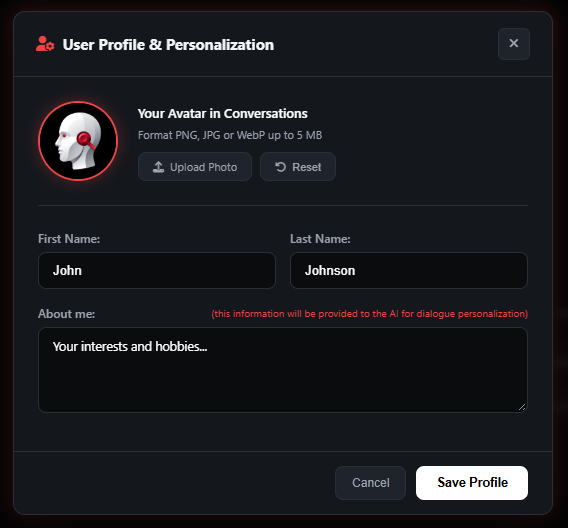
</p>

---

## ⚠️ Важное примечание: Статус Beta (Important Beta Notice)

> **Статус релиза:** **v9.0-beta**  
> Данная рабочая станция является активной **Бета-версией**.  
> Система всесторонне разрабатывалась, тестировалась и оптимизировалась на конфигурации:  
> **AMD Ryzen (Zen 4, 16 потоков) + AMD Radeon 780M (Vulkan GPU Acceleration) под управлением Windows 11** с квантованным семейством нейросетей **Bonsai (Ternary-Bonsai-2-9B / Bonsai-8B)** и **Gemma**.
> 
> *Архитектура платформы универсальна и полностью совместима с видеокартами AMD Radeon, NVIDIA GeForce/RTX и Intel Arc / Iris Xe под управлением Windows 10 и 11 без конфликтов с драйверами.*

---

## 🌟 Ключевые возможности

### 1. ⚡ SREDA Boost — Игровой режим системных ресурсов
- **Приоритезация вычислительного ядра:** Автоматически переводит процесс инференса (`llama-server.exe`) в приоритет `High`, гарантируя стабильную скорость генерации без фризов.
- **Интеллектуальная компактизация ОЗУ:** По требованию и перед запуском тяжелых моделей вызывает Windows Working Set Trim API (`SetProcessWorkingSetSize`), освобождая сотни мегабайт памяти для графического ядра (UMA / VRAM).
- **Безопасный Hardware-Friendly Throttling:** Встроенный белый список (Whitelist) защищает ключевые драйверы и сервисы **AMD** (`amdfendrs`, `radeonsoftware`), **NVIDIA** (`nvcontainer`, `nvdisplay`), **Intel** (`igfx`, `arccontrol`) и системные процессы Windows от сбоев.

### 2. 🧠 Локальный инференс текста и рассуждений (LLM Engine)
- Полнофункциональный локальный бэкенд на базе высокопроизводительного `llama-server` с аппаратным ускорением **Vulkan**.
- Поддержка **Flash Attention (`-fa on`)**, экономящего до 40% VRAM на контексте и ускоряющего работу с RAG-документами.
- Поддержка контекста до 8192+ токенов и гибкое распределение слоев (GPU Offloading: 0–99 слоев).
- Каталог моделей с возможностью поиска и загрузки моделей формата **GGUF** с Hugging Face прямо из интерфейса.

### 3. 🌐 Внешние облачные API (Cloud Models — 0 МБ локальной видеопамяти)
Если у вас нет мощной видеокарты, SREDA AI позволяет подключить флагманские модели по API:
- **Сбер GigaChat:** Поддержка `GigaChat 2 Max`, `GigaChat 2 Pro`, `GigaChat 2` и `GigaChat 1.x`. Встроенная поддержка Client ID / Secret, Base64 авторизационных строк и авто-валидация TLS-сертификатов Минцифры РФ.
- **OpenRouter:** Мгновенный доступ к `DeepSeek V3`, `DeepSeek R1` (глубокие рассуждения), `Claude 3.5 Sonnet`, `Llama 3.3 70B`, `GPT-4o` и бесплатным моделям.
- **Пользовательские OpenAI-совместимые API:** Подключение локальных серверов (vLLM, Ollama, LM Studio) или сторонних провайдеров.

### 4. 🎙️ Синтез и распознавание речи (Full Offline Voice)
- **Офлайн STT (Whisper):** Распознавание голоса с микрофона без обращения к сторонним серверам.
- **Офлайн TTS (Piper Neural Voices):** Высококачественная нейроозвучка на русском (голоса *Дмитрий* и *Ирина*) и английском (*Lessac*) языках.
- **Автоозвучка:** Режим диалога в реальном времени — модель автоматически озвучивает свои ответы.
- **Модульная дозагрузка:** Дикторы загружаются по требованию из интерфейса настроек (~60 МБ).

### 5. 🎨 Генерация графики, музыки и распознавание образов
- **Stable Diffusion (SDXS-512):** Дистиллированная сверхбыстрая модель генерации изображений за 1–2 шага через Vulkan.
- **Генерация музыки:** Музыкальные фрагменты и физическое моделирование акустических струн (Karplus-Strong / MusicGen ONNX).
- **Компьютерное зрение:** Анализ и автоописание загруженных пользователем картинок и скриншотов (ViT-GPT2).

### 6. 📚 RAG & Live Data Hub
- Разбор и индексация документов форматов **PDF, DOCX, TXT, Markdown**.
- Живые данные: мониторинг курсов валют (ЦБ РФ), свежие новости по RSS, погода и поисковые сводки.
- Интеграция с 3D-пакетом **Blender MCP** для моделирования и управления сценами.

---

## 🖥️ Системные требования и совместимость

| Компонент | Минимальные требования | Рекомендуемые требования |
| :--- | :--- | :--- |
| **ОС** | Windows 10 (64-bit, 20H2+) | Windows 11 (64-bit, 22H2 / 23H2 / 24H2) |
| **Процессор** | 4 ядра / 8 потоков (Intel Core i5 / AMD Ryzen 5) | 8 ядер / 16 потоков (AMD Ryzen Zen 4 / Intel 13th+ Gen) |
| **Память (RAM)** | 8 ГБ (для Cloud API или 3B моделей) | 16–32 ГБ (для моделей 7B–9B и мультимодальности) |
| **Видеокарта** | Любая с поддержкой Vulkan 1.2+ или CPU | AMD Radeon 780M / RX 6000+, NVIDIA RTX 3060+, Intel Arc A770 |
| **Python** | Python 3.10 – 3.14 | Python 3.11 или 3.12 |

---

## 🚀 Быстрый старт (Installation & Quickstart)

### Шаг 1. Клонирование репозитория
```bash
git clone https://github.com/MarkusMarrei/sreda-ai.git
cd sreda-ai
```

### Шаг 2. Установка Python-зависимостей
Рекомендуется использовать стандартное окружение Python 3.10+:
```bash
pip install -r requirements.txt
```

### Шаг 3. Настройка моделей (One-Click Setup)
Тяжелые веса моделей (>100 МБ) не хранятся в репозитории Git. Чтобы быстро скачать нужные компоненты, запустите скрипт:
```bash
setup_models.bat
# или через Python:
python download_models.py
```
*Вы можете выбрать: загрузить только голосовые модели (~260 МБ), графику (~650 МБ), текстовую модель Bonsai 2 (~1.9 ГБ), либо использовать исключительно Cloud API (0 МБ на диске).*

### Шаг 4. Запуск рабочей станции
Дважды кликните по:
```bash
run.bat
# или выполните в консоли:
python run.py
```
Скрипт автоматически:
1. Проверит и освободит порты `8000`, `8080`, `1234`.
2. Создаст фирменный ярлык **SREDA AI** на рабочем столе.
3. Запустит ядро FastAPI и откроет рабочую станцию в отдельном окне приложения.

---

## 📁 Структура проекта (Project Architecture)

```
SREDA-AI/
├── backend/                  # Серверное ядро (FastAPI, Python)
│   ├── main.py               # Главный роутер API и WebSocket-потоки
│   ├── llama_engine.py       # Управление жизненным циклом llama-server
│   ├── boost_service.py      # Служба оптимизации ресурсов SREDA Boost
│   ├── provider_service.py   # Интеграция Cloud API (GigaChat, OpenRouter)
│   ├── audio_service.py      # Синтез (Piper) и распознавание речи (Whisper)
│   ├── multimedia_orchestrator.py # Диспетчер генерации картинок и музыки
│   ├── system_info.py        # Диагностика CPU, GPU (AMD/NVIDIA/Intel) и RAM
│   ├── hf_hub.py             # Интеграция поиска и загрузки моделей Hugging Face
│   ├── rag_service.py        # Векторизация и поиск по документам
│   ├── data_hub_service.py   # RSS-потоки, курсы валют ЦБ РФ, новости
│   └── config/               # Конфигурационные файлы (boost, providers)
├── docs/                     # Документация и медиа-активы
│   └── screenshots/          # Скриншоты интерфейса рабочей станции
├── engine/                   # Готовые бинарные движки инференса
│   ├── llama-server.exe      # Высокопроизводительное ядро с поддержкой Vulkan
│   ├── ffmpeg.exe            # Конвертер медиапотоков
│   ├── sd/                   # Движок Stable Diffusion (sd-cli.exe)
│   └── audio/                # Движки piper.exe и whisper-cli.exe
├── frontend/                 # Пользовательский интерфейс рабочей станции
│   ├── index.html            # SPA-интерфейс, адаптивные модальные окна
│   ├── css/theme.css         # Неоновая киберпанк/дарк тема, анимации
│   ├── js/app.js             # Клиентская логика, мультиязычность I18N
│   └── assets/               # Логотипы, иконки, аватары
├── models/                   # Директории для локальных весов (.gitkeep)
│   ├── audio/                # Модели Piper TTS и Whisper STT
│   ├── sd/                   # Модели Stable Diffusion GGUF
│   └── vision/               # Модели компьютерного зрения
├── download_models.py        # Автоматический загрузчик моделей
├── setup_models.bat          # Батник быстрого запуска загрузчика
├── run.py                    # Главный запускающий лаунчер с мониторингом
├── run.bat                   # Быстрый старт в 1 клик
├── requirements.txt          # Список зависимостей Python
├── LICENSE                   # Лицензия Apache License 2.0
├── README.md                 # Английская версия документации
└── README_RU.md              # Русская версия документации
```

---

## 🌍 Мультиязычность (Internationalization)

Интерфейс SREDA AI поддерживает динамическое переключение языка на лету без перезагрузки:
- Русский (RU)
- English (EN)
- Deutsch (DE), Français (FR), Español (ES), Português (PT), Italiano (IT), 日本語 (JA), 한국어 (KO)

Авторство и системные метаданные автоматически адаптируются:
- RU: **Автор: Маркус Маррей** | **Версия: v9.0-beta**
- EN: **Author: Markus Marrei** | **Version: v9.0-beta**

---

## 🔒 Безопасность и конфиденциальность (Privacy & Clean Defaults)

- Все персональные пути, тестовые аудиозаписи и учетные записи очищены в репозитории.
- Файл конфигурации провайдеров `backend/config/providers.json` по умолчанию содержит пустые шаблоны и добавлен в `.gitignore`.
- Ваши локальные чаты, файлы RAG и сгенерированные медиафайлы хранятся исключительно на вашем ПК и не передаются третьим лицам.

---

## 📜 Лицензия (License)

Проект распространяется под свободной лицензией **Apache License 2.0**.  
Подробности смотрите в файле [LICENSE](LICENSE).

```text
Copyright 2026 Markus Marrei (Маркус Маррей)

Licensed under the Apache License, Version 2.0 (the "License");
you may not use this file except in compliance with the License.
You may obtain a copy of the License at

    http://www.apache.org/licenses/LICENSE-2.0
```

---

<p align="center">
  Разработано с заботой о максимальной производительности и свободе локального ИИ.<br>
  <strong>Маркус Маррей (Markus Marrei) • SREDA AI</strong>
</p>
